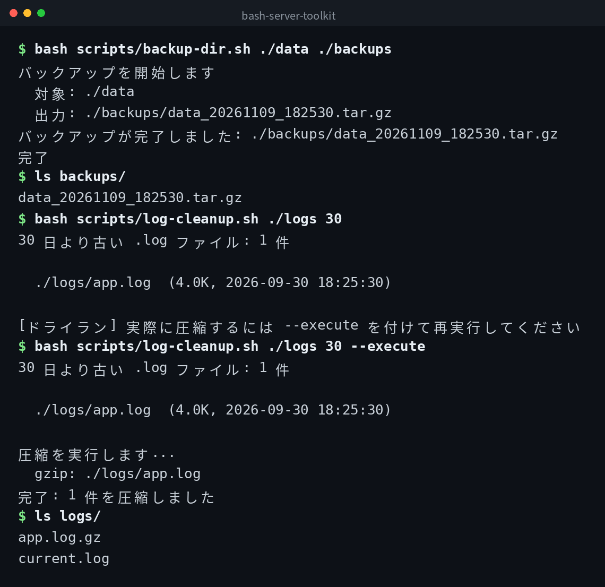

English | [日本語](ja/README.md) | [한국어](ko/README.md)


# bash-server-toolkit

A collection of Bash scripts for practical server operations.

## Demo



## Prerequisites

- Bash 4.0 or later
- GNU coreutils (`tar`, `df`, `du`, `find`, `gzip`)

## Scripts

### backup-dir.sh

Backs up a specified directory as a tar.gz archive and keeps only the latest 7 generations.

```bash
bash scripts/backup-dir.sh /var/www/html /backup/www
```

The output filename includes a timestamp, such as `html_20261109_020000.tar.gz`. Backups beyond the 7th oldest are automatically deleted.

### disk-report.sh

Displays an overview of filesystem usage and the top 10 subdirectories by size under a specified directory.

```bash
# Target / by default
bash scripts/disk-report.sh

# Target a specific directory
bash scripts/disk-report.sh /home
```

### log-cleanup.sh

Compresses old `.log` files in a specified directory with gzip. By default it runs in dry-run mode (only lists targets). Add `--execute` to actually compress.

```bash
# Dry run: list .log files older than 30 days
bash scripts/log-cleanup.sh /var/log/myapp 30

# Actually compress
bash scripts/log-cleanup.sh /var/log/myapp 30 --execute
```

## Cron Example

To back up `/var/www/html` every day at 2:00 AM:

```cron
0 2 * * * /path/to/bash-server-toolkit/scripts/backup-dir.sh /var/www/html /backup/www >> /var/log/backup.log 2>&1
```

## Clone

```bash
git clone https://github.com/mivork/bash-server-toolkit.git
```
