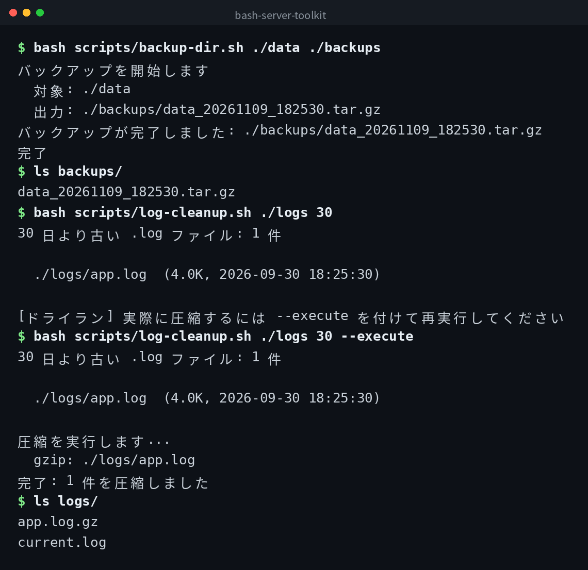

[English](../README.md) | 日本語 | [한국어](../ko/README.md)


# bash-server-toolkit

サーバー運用で実際に使える Bash スクリプト集です。

## デモ



## 前提

- Bash 4.0 以上
- GNU coreutils（`tar`, `df`, `du`, `find`, `gzip`）

## スクリプト一覧

### backup-dir.sh

指定ディレクトリを tar.gz にバックアップし、最新 7 世代だけ残します。

```bash
bash scripts/backup-dir.sh /var/www/html /backup/www
```

出力ファイル名は `html_20261109_020000.tar.gz` のように日時が付きます。
8 件目以降の古いバックアップは自動的に削除されます。

### disk-report.sh

ファイルシステム全体の使用状況と、指定ディレクトリ配下のサブディレクトリ使用量トップ 10 を表示します。

```bash
# / を対象（デフォルト）
bash scripts/disk-report.sh

# 特定のディレクトリを対象
bash scripts/disk-report.sh /home
```

### log-cleanup.sh

指定ディレクトリ内の古い `.log` ファイルを gzip 圧縮します。
デフォルトはドライランで、`--execute` を付けたときだけ実際に圧縮します。

```bash
# 30 日より古い .log を一覧表示（ドライラン）
bash scripts/log-cleanup.sh /var/log/myapp 30

# 実際に圧縮する
bash scripts/log-cleanup.sh /var/log/myapp 30 --execute
```

## cron への登録例

毎日午前 2 時に `/var/www/html` をバックアップする場合:

```cron
0 2 * * * /path/to/bash-server-toolkit/scripts/backup-dir.sh /var/www/html /backup/www >> /var/log/backup.log 2>&1
```

## クローン

```bash
git clone https://github.com/mivork/bash-server-toolkit.git
```
