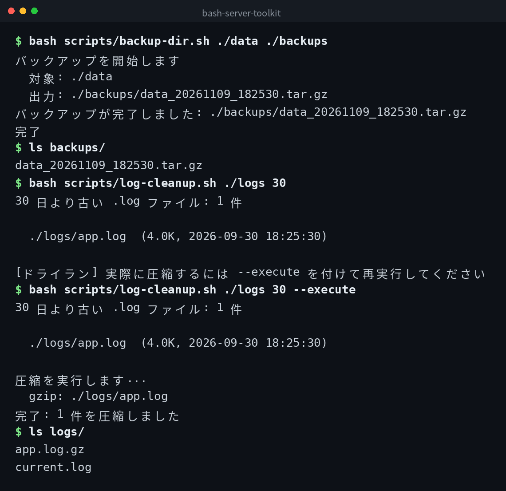

[English](../README.md) | [日本語](../ja/README.md) | 한국어


# bash-server-toolkit

서버 운용에 실제로 사용할 수 있는 Bash 스크립트 모음입니다.

## 데모



## 전제 조건

- Bash 4.0 이상
- GNU coreutils (`tar`, `df`, `du`, `find`, `gzip`)

## 스크립트 목록

### backup-dir.sh

지정한 디렉토리를 tar.gz로 백업하고 최신 7세대만 유지합니다.

```bash
bash scripts/backup-dir.sh /var/www/html /backup/www
```

출력 파일명은 `html_20261109_020000.tar.gz`와 같이 타임스탬프가 포함됩니다. 8번째 이후의 오래된 백업은 자동으로 삭제됩니다.

### disk-report.sh

파일 시스템 전체의 사용 현황과 지정 디렉토리 하위의 서브디렉토리 사용량 상위 10개를 표시합니다.

```bash
# / 를 대상 (기본값)
bash scripts/disk-report.sh

# 특정 디렉토리를 대상
bash scripts/disk-report.sh /home
```

### log-cleanup.sh

지정 디렉토리 내의 오래된 `.log` 파일을 gzip으로 압축합니다. 기본적으로 드라이런 모드이며, `--execute`를 붙이면 실제로 압축합니다.

```bash
# 30일보다 오래된 .log 목록 표시 (드라이런)
bash scripts/log-cleanup.sh /var/log/myapp 30

# 실제로 압축
bash scripts/log-cleanup.sh /var/log/myapp 30 --execute
```

## cron 등록 예시

매일 오전 2시에 `/var/www/html`을 백업하는 경우:

```cron
0 2 * * * /path/to/bash-server-toolkit/scripts/backup-dir.sh /var/www/html /backup/www >> /var/log/backup.log 2>&1
```

## 클론

```bash
git clone https://github.com/mivork/bash-server-toolkit.git
```
